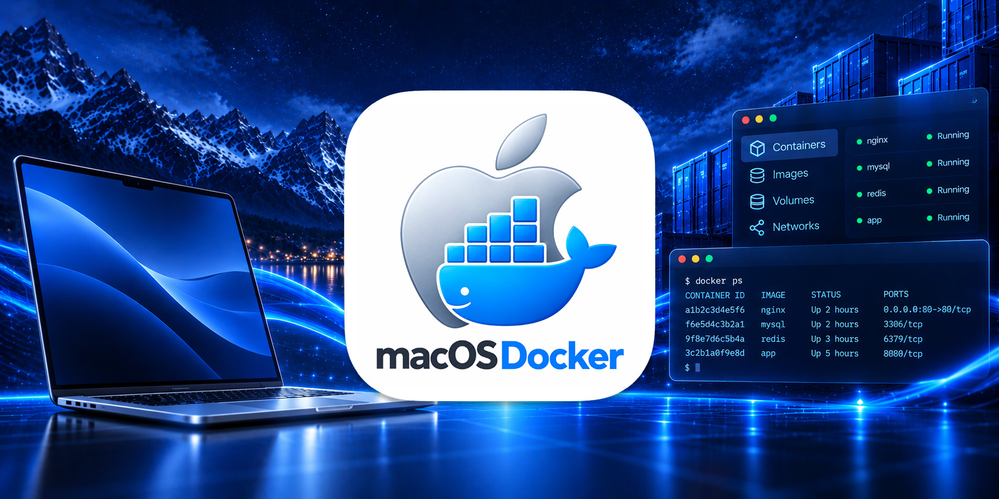
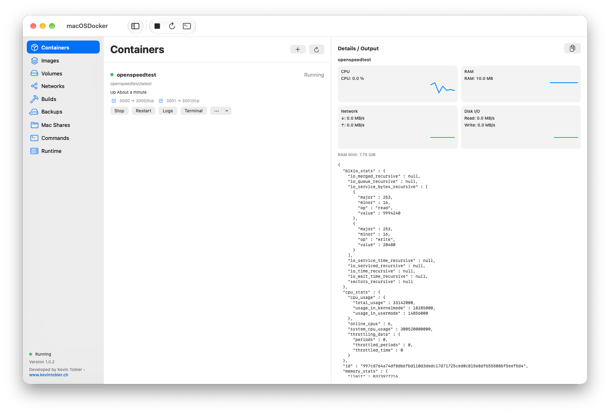
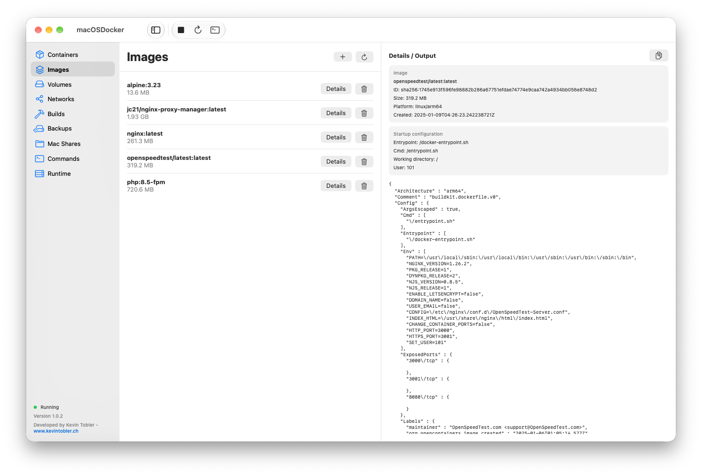
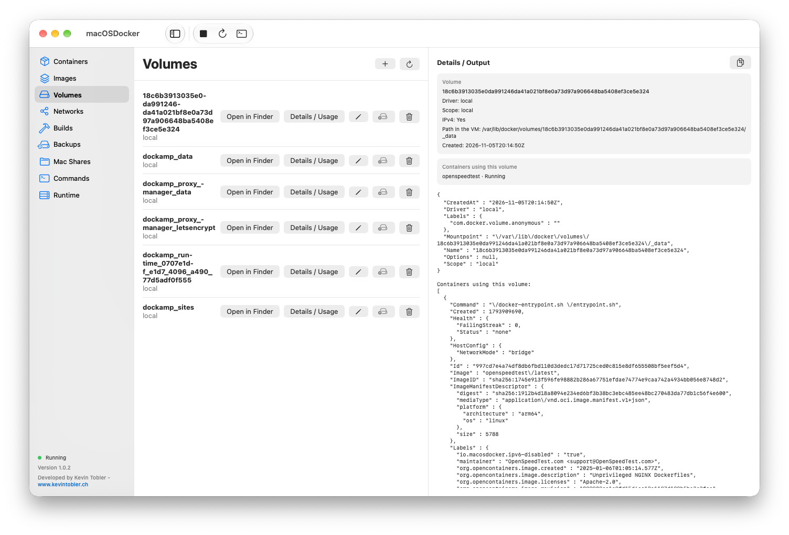
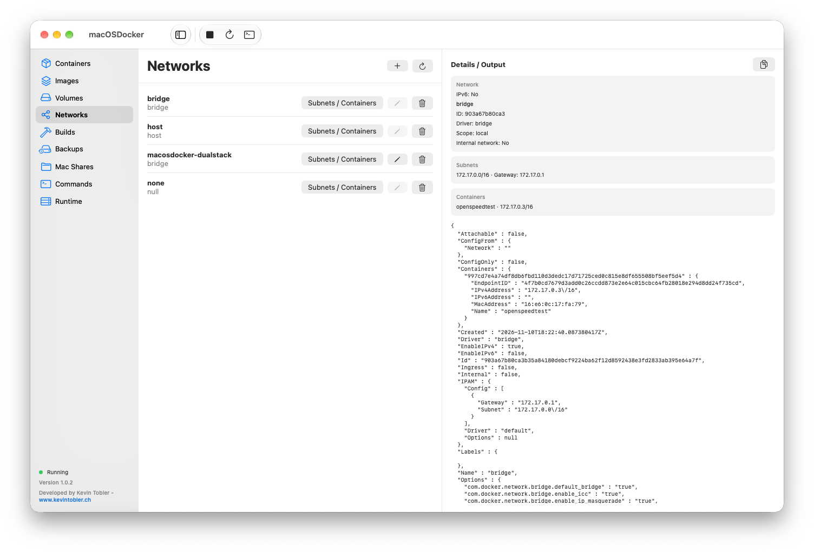
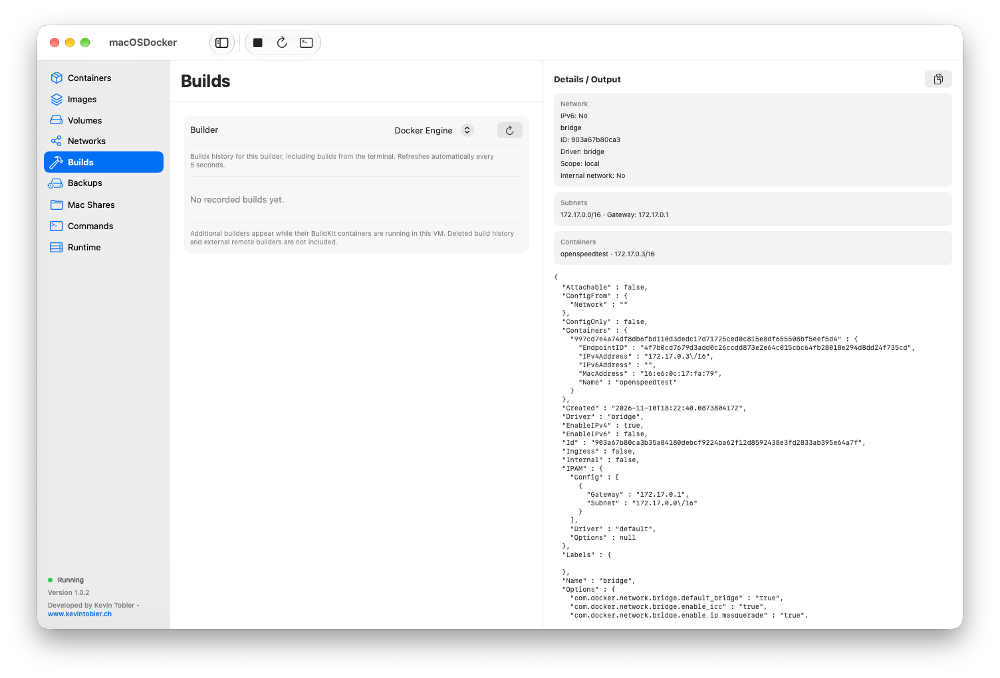
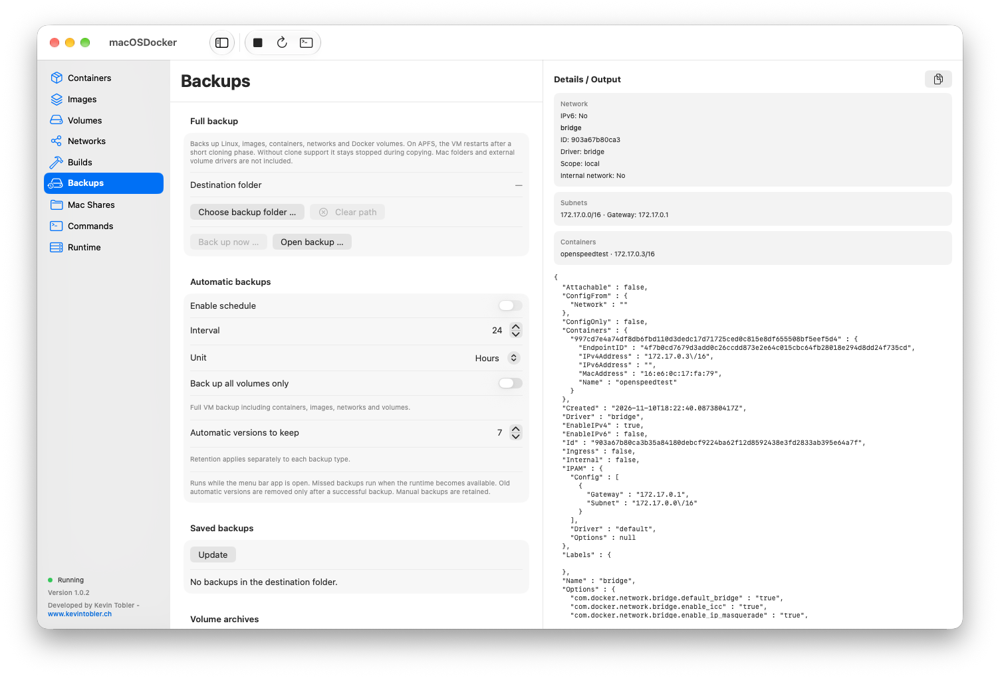
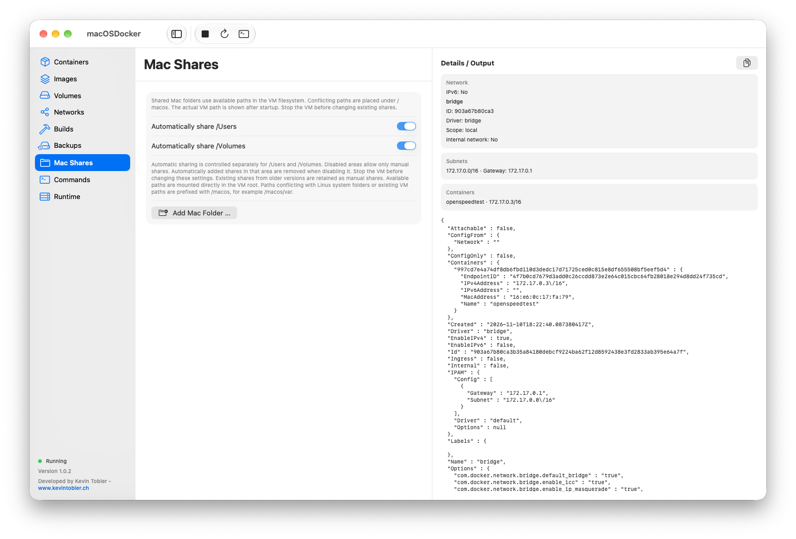
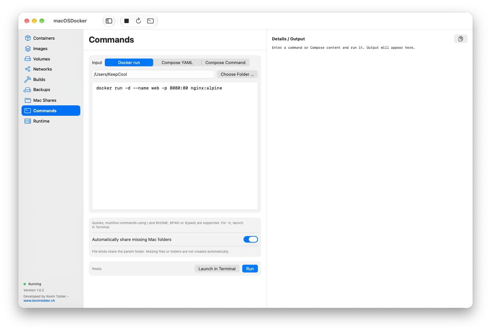
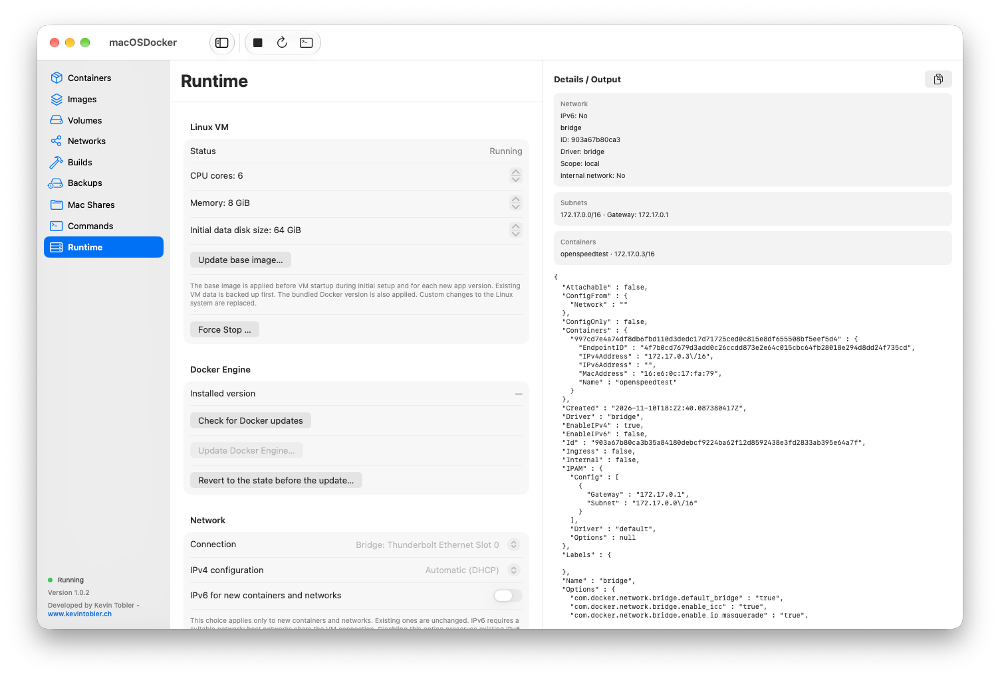

# 🐳 macOSDocker for macOS

**macOSDocker** is a native macOS app for running and managing Docker containers on Apple Silicon. It includes its own lightweight Linux VM, Docker Engine, Docker CLI, Compose and Buildx, with a dashboard and quick controls in the menu bar.

Current project version **1.0.2** | Build **3** | Developed by **Kevin Tobler** 🌐 [www.kevintobler.ch](https://kevintobler.ch)

---

🍎 **Apple Silicon · macOS 14.6 Sonoma or newer**

Run containers without installing Docker Desktop, OrbStack or a separate Linux distribution. The bundled Linux system uses Apple's Virtualization.framework for hardware-accelerated virtualization and VirtioFS for Mac folder sharing.

[](https://github.com/KeepCoolCH/macOSDocker/releases/tag/1.0.2)

---

## 🚀 Main features

### Dashboard and menu bar

- Native SwiftUI dashboard in English and German
- Dashboard opens automatically when the app starts
- Menu bar controls for starting, stopping and restarting the VM
- Separate lists of running and stopped containers with quick actions
- Open published container ports in the browser
- Container actions for start, stop, restart, logs, terminal and inspection
- Activity indicator while operations are running
- Closing the dashboard keeps the VM and menu bar app running
- Dock icon and full application menu while the dashboard is open
- Optional launch at login
- Stable menu bar item identity for menu bar customizer apps

### Containers and images

- Manage all containers in the app's Docker Engine, including containers created through CLI, Compose or other Docker clients
- Create containers from images with network, port and storage selection
- Automatically stop running containers before deletion
- Container details, published ports, networks and mounts shown as summary cards alongside raw JSON
- Live CPU, memory, network and disk I/O charts in the resource view
- Container logs and interactive terminals
- Pull, inspect and delete images
- Automatic inventory updates using Docker events and periodic reconciliation

### Commands, Compose and builds

- Run pasted `docker run` commands directly in the app
- Start stacks from inline Compose YAML or existing Compose files
- Select a working directory and Compose project name
- Live command output, exit codes and cancellation
- Bundled Docker CLI, Compose and Buildx
- Build history with details, logs and deletion
- Terminal integration with a dedicated Docker context
- Switch the terminal default between macOSDocker and other Docker installations

### Mac folder sharing

- Add Mac folders through Finder with individual read-only settings
- Independent switches for automatic sharing of bind sources below `/Users` and `/Volumes`
- Automatic sharing works with app commands, the app's terminal and Docker API clients
- Multiple folders share one VirtioFS device, without a fixed folder-count limit
- Add new shares while the VM is running
- Preserve full Mac paths where they do not conflict with Linux system directories
- Use the full path below `/macos` for conflicting directories
- Display the actual VM mount path in the app

### Volumes and Finder access

- Create, inspect and delete Docker volumes
- See which containers use a volume
- Rename supported unused local volumes through a verified data migration
- Open local volumes in Finder over SMB
- Optional automatic Finder mounting after startup
- Export volumes as TAR archives and import archives into new volumes

### Networking

- NAT networking with published TCP ports available through the Mac where forwarding can bind the port
- Native bridge networking with adapter selection and a separate LAN IP for the VM
- Automatic or manual IPv4 configuration in bridge mode
- Optional IPv6, disabled by default
- Create Docker bridge, macvlan and ipvlan networks
- Network details with subnets, addresses and attached containers
- Rename supported Docker networks through migration
- Networks created through CLI or Compose appear automatically
- Macvlan availability follows the VM's network mode

### Backups and maintenance

- Full VM backups including Linux, images, containers, networks and local Docker volumes
- APFS cloning to reduce VM downtime, with a regular-copy fallback
- Manual backup and restore with integrity checks
- Scheduled full backups or archives of all supported local volumes
- Configurable intervals in hours, days, weeks or months
- Backup folder selection and configurable version retention
- Docker Engine update checks, updates and recovery
- Automatic base image setup before the first VM start
- Base image refresh before starting each new app version or build, with a recovery snapshot for existing VM data
- Automatic cleanup of obsolete recovery snapshots
- App update checks from the application menu, menu bar menu or Runtime settings

---

## 📸 Screenshots

  
  
  
  
  
  
  
  
  

---

## ⚙️ Requirements

- Apple Silicon Mac
- macOS **14.6 Sonoma or newer**
- Enough free storage for the Linux system, container images, volumes and backups
- Internet access to pull images and check for updates
- An Ethernet adapter and a suitable LAN configuration when using bridge mode or macvlan

Docker Desktop, OrbStack, Homebrew and Xcode are **not required to run the built app**.

## 🔧 Installation

1. Copy `macOSDocker.app` from the downloaded release into **Applications**.
2. Open the app. The dashboard appears and the bundled Linux system is installed before the VM starts.
3. Open **Runtime** to adjust CPU, memory and networking if needed.
4. Add the Mac folders your containers need under **Mac Shares**, or configure automatic sharing.
5. Pull an image under **Images** and create a container under **Containers**, or use **Commands**.

The data disk capacity is selected when the VM is first created. It is a sparse disk, so its host storage use grows with the data stored inside it. Changing the capacity setting does not resize an existing disk.

## 🧩 Usage

### Start your first container

Open the app's terminal and run:

```sh
docker run -d \
  --name hello-nginx \
  --restart unless-stopped \
  -p 8080:80 \
  nginx:alpine
```

The container appears automatically in the dashboard and menu bar. Click its published port to open it in the browser.

In NAT mode, use the Mac's published address where TCP forwarding is available. In bridge mode, use the VM's LAN IP, for example `http://VM-IP:8080`. The app displays the applicable address.

### Use Docker Compose

Paste the following into **Commands** in Compose mode:

```yaml
services:
  web:
    image: nginx:alpine
    restart: unless-stopped
    ports:
      - "8080:80"
```

Choose a project name and start the stack. Running the same project again updates it with `docker compose up -d`.

You can also load a Compose file or run `docker compose -f compose.yaml -p demo up -d`. Relative paths and `.env` files use the selected working directory. Use the terminal for other Compose actions such as `down`.

### Use the terminal

The app's terminal connects directly to its own Docker Engine. Under **Runtime**, you can also make the bundled tools the default for new zsh terminals and later switch back to another Docker installation.

For an existing Docker CLI, connect explicitly without changing its default context:

```sh
docker --host "unix://$HOME/.macosdocker/docker.sock" ps -a
docker --host "unix://$HOME/.macosdocker/docker.sock" compose -f compose.yaml up -d
```

The integration installs a launcher under `~/.macosdocker/bin` and updates the zsh configuration. It does not replace other Docker binaries. The app keeps its Docker configuration and credentials separate; use `docker login` in the app's terminal when needed.

Pasted commands support quoting, line continuations, `$HOME`, `$PWD` and `$(pwd)`. They are passed to Docker as arguments rather than executed as a host shell script. Use the terminal for interactive commands, pipes and host shell operations.

### Share Mac folders

Under **Mac Shares**, add folders manually or enable automatic sharing separately for `/Users` and `/Volumes`.

When automatic sharing is disabled for a location, only manually added shares are allowed there. Other Mac paths must be added explicitly. Files used as bind sources share their parent directory. Missing Mac files and folders are rejected instead of silently creating empty VM directories.

For example, a shared Mac folder at `/Users/yourname/sites` normally remains `/Users/yourname/sites` inside the VM. If a path conflicts with a Linux system directory, it is placed below `/macos`, for example `/macos/var`. Docker bind paths are resolved to the correct VM location automatically.

New shares can be added while running. Stop the VM before removing a share or changing its permissions. Native Docker volumes remain on the VM's data disk; `/var/run/docker.sock` refers to the VM's Docker socket.

### Open volumes in Finder

Choose **Open in Finder** on a supported local volume. SMB starts on demand with a randomly generated password for the VM session.

- **NAT:** a local connection carries SMB through VirtioSocket.
- **Bridge:** Bonjour discovers the VM's SMB service on port 445, with its checked IP address as fallback.
- Finder mounts are stored below `~/.macosdocker/volumes`.

Close open files before stopping the VM. Volumes using external drivers or additional mount options cannot be exported through this feature. Avoid editing live database files in Finder.

Renaming a volume requires a supported local volume with no attached containers, including stopped containers. The app copies and verifies its data before removing the old volume. Update Compose files and other external references to the new name afterwards.

## 🌐 Networking

### NAT

NAT gives the VM its own private network connection. Published ports are reachable through the VM's IP. The app additionally forwards supported TCP ports to available ports on the Mac, including optional IPv6 listeners where supported.

The Mac-side TCP forwarding does **not preserve the original client IP**. Publishing a port does not make every internal Docker container IP directly accessible from the LAN. UDP publishing is not handled by this TCP forwarder.

### Bridge

Bridge mode uses Apple's native Virtualization.framework connection through the selected adapter. The VM receives its own LAN IP, and published ports are accessed through that IP without Mac-side TCP forwarding.

Use Ethernet for bridge networking. DHCP can assign the address automatically, or you can configure IPv4 manually under **Runtime**. Optional IPv6 can use automatic or manual configuration where the network supports it.

The VM's NAT/bridge setting is separate from Docker's network driver. A container can use a Docker **bridge** network while the VM itself uses **NAT**.

### Macvlan and ipvlan

Create networks under **Networks**, with the subnet and parent interface appropriate for your LAN. The VM adapter is normally `eth0`. IPvlan L3 and L3S require suitable external routes.

Macvlan requires the VM to use bridge mode. Under NAT, existing macvlan networks remain visible but unavailable for container use; inspection and deletion remain possible. Starting a macvlan container can prompt for a bridge switch. After switching, run the original command or start the container again.

### Optional IPv6

IPv6 is disabled by default. Enabling it applies the creation policy to **new containers and networks**; existing ones are not converted automatically. New containers using the default network are placed on a managed dual-stack network. Custom networks must support IPv6 themselves.

Disabling the option again does not rewrite existing containers or remove their existing IPv6 bindings. Availability outside the VM depends on the Mac and LAN configuration. Some container images or applications may need additional configuration when IPv6 is enabled.

## 💾 Backup and restore

Under **Backups**, select a destination folder and create a full backup or export individual volumes.

| Backup type | Included |
| --- | --- |
| Full VM backup | Linux system, Docker images, containers, networks and local Docker volumes |
| Volume archive | Data and file permissions from one supported local Docker volume |
| Scheduled volume backup | Separate archives of all supported local Docker volumes |

Full backups briefly stop the VM for a consistent state. When APFS cloning is supported, the app can restart the VM after the clone phase and continue saving and verifying the backup in the background. Without cloning, the VM remains stopped during the copy.

Scheduled backups support hours, days, weeks and months, with a configurable number of retained automatic versions per backup type. Scheduling runs while the menu bar app is open. Missed runs are caught up when the runtime becomes available. Old automatic versions are removed only after a successful backup; manual backups are retained.

Volume exports stop containers using the selected volume and restart them afterwards. Imports create a new volume rather than overwriting an existing one.

> [!IMPORTANT]
> Full VM backups do not include shared Mac folders or data managed by external volume drivers. Back up those locations separately. Restoring a full backup replaces the VM's Docker state; the app creates a recovery snapshot first when existing data is present.

## 🔄 Updates

### App updates

Choose **Check for App Updates…** from the application menu or menu bar menu. **Runtime → App** also offers a manual check and an optional daily automatic check, disabled by default.

Available downloads open in the browser and are installed manually. App update checks do not stop the VM or update Docker Engine.

### Linux base image

The bundled base image is installed automatically before the first VM start. Each new app version or build refreshes it before starting the existing VM, with a recovery snapshot of the previous system and data first. Normal restarts reuse the installed image.

Use **Update base image** under **Runtime** to apply it manually. Docker data is preserved, but custom changes to the Linux system are replaced. If startup fails after an automatic refresh, the app restores the previous system and data disks.

### Docker Engine

Under **Runtime → Docker Engine**, check for available updates. The update button becomes available only after a newer version has been detected. The app creates a recovery snapshot before updating. The restore action uses the newest complete recovery snapshot, including its earlier Docker data.

## 📁 App data

The runtime is stored in:

```text
~/Library/Application Support/macOSDocker/
```

| Location | Contents |
| --- | --- |
| `image/` | Linux kernel, initramfs and writable system image |
| `data.raw` | Sparse data disk containing Docker images, containers and volumes |
| `settings.json` | VM settings and Mac folder shares |
| `docker-config/` | App-specific Docker configuration and credentials |
| `compose-projects/` | Saved Compose sources and resolved configurations |
| `engine-recovery/` | Recovery snapshots for updates and restores |
| `console.log` | Console output from the latest VM start |

Open this folder from **Runtime → App → Open app data folder in Finder**. Recovery cleanup preserves the current rollback snapshots and removes obsolete complete snapshots. Scheduled backup retention is managed separately in the selected backup folder.

## 🌍 Language

Choose **System Default**, **English** or **German** from the app's language menu. Restart the app for the change to take effect. Docker/Linux output, commands, paths and object names retain their original text.

## 🛠️ Troubleshooting

### The VM waits for a network address

If startup reports `Guest networking did not become ready` and the console repeatedly shows `udhcpc: broadcasting discover`, DHCP is not receiving a usable reply. Check the selected adapter, DHCP service, VPN and firewall rules. Tools such as Murus can block DHCP traffic on the virtual network; DHCP uses UDP ports 67 and 68.

### A container is reachable through the VM IP but not the Mac IP

In bridge mode, use the VM's LAN IP. In NAT mode, check that the published port uses TCP and that its port is available on the Mac. Another application may already occupy it, or a firewall may block access from other devices.

### A Mac bind mount is missing or denied

Check **Mac Shares** and the automatic sharing switches for `/Users` and `/Volumes`. The source must exist on the Mac and be covered by an allowed share. Use the displayed VM path when inspecting a conflicting mount below `/macos`.

## 🧑‍💻 Build from source

Building requires an Apple Silicon Mac, Xcode, Python 3 and a running ARM64-capable Docker Engine. End users do not need these tools.

```sh
./scripts/build-linux.sh
./scripts/build-app.sh
```

The scripts build the minimal Linux image, download pinned Docker tools, verify their checksums and bundle the app. The guest contains a custom Linux kernel, Docker Engine, containerd, runc, BusyBox, a small init process and services needed for app features. It does not install a full distribution, systemd or a package manager.

The Xcode project enables Hardened Runtime and uses the virtualization and native networking entitlements. Building a separately signed bridge-capable app requires Apple's approval for `com.apple.vm.networking` for the relevant signing identity and distribution method.

For an Xcode archive, use `App archivieren.command`. See the dedicated documentation for build and release details:

- [Architecture](docs/ARCHITECTURE.md)
- [Kernel builds](docs/KERNEL-BUILD.md)
- [Signing and notarization](docs/SIGNING.md)

Local build outputs, VM disks, downloaded tools and private signing files are excluded from Git. Publish the built app as a separate release artifact. Required bundled-tool license texts are included under `vendor/docker-tools` and in the built app.

---

## 🧑‍💻 Developer

**Kevin Tobler**  
🌐 [www.kevintobler.ch](https://www.kevintobler.ch)  
